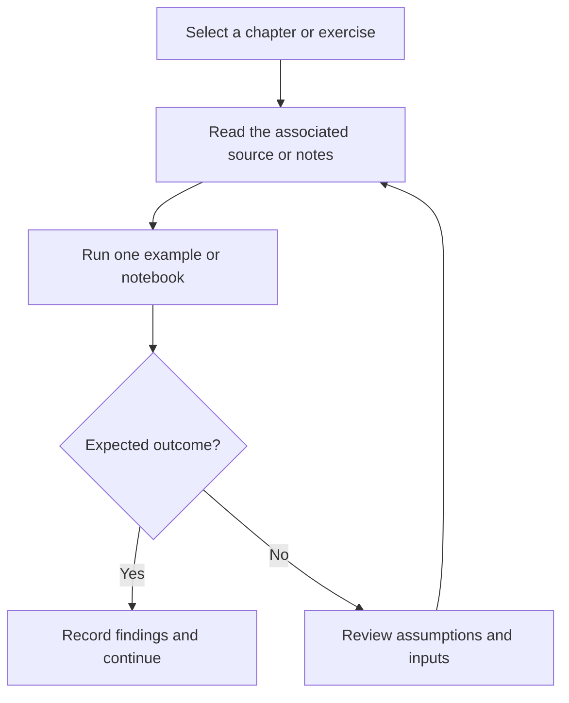

# OCI Generative AI Professional — Study Guide

OCI Generative AI study notes covering LLM foundations, service concepts, RAG, and Oracle vector search.

## Project focus

Learning notes and notebooks. Use the directory map to choose a focused example or learning topic instead of treating the repository as one application.

## Workflow



The diagram describes how to work through the material; it is not a deployed service topology.

## Repository structure

| Path | Purpose |
| --- | --- |
| [`1 - Fundamentals of Large Language Models/`](1%20-%20Fundamentals%20of%20Large%20Language%20Models) | Topic-organized learning material and examples. |
| [`2 - OCI Generative AI Service/`](2%20-%20OCI%20Generative%20AI%20Service) | Topic-organized learning material and examples. |
| [`3 - RAG using Generative AI service and Oracle 23 ai Vector Search/`](3%20-%20RAG%20using%20Generative%20AI%20service%20and%20Oracle%2023%20ai%20Vector%20Search) | Topic-organized learning material and examples. |
| [`Books/`](Books) | Project-specific source, resources, or learning material. |

## Getting started

```bash
git clone https://github.com/Raimal-Raja/Certfied-Oracle-Cloud-Infrastructure-Generative-AI-Professional-2025.git
cd Certfied-Oracle-Cloud-Infrastructure-Generative-AI-Professional-2025
```

```bash
python -m venv .venv
source .venv/bin/activate
```

On Windows PowerShell, activate the environment with `.venv\Scripts\Activate.ps1` instead.

Open one `.ipynb` file in Jupyter, VS Code, Kaggle, or Colab. Read its dependency and dataset cells before execution. Notebook paths and model/data requirements vary; this repository is not one shared deployable application.

## Verification

Use the setup commands and inspect the selected interface, example, or notebook with known inputs. This documentation review checks repository paths and dependency declarations; it does not claim fresh end-to-end execution or model-quality measurements.

## Detailed project guide

The **Oracle Cloud Infrastructure (OCI) Generative AI Course** provides an **in-depth technical introduction** to **Large Language Models (LLMs)** and their applications. This course explores **LLM architecture**, **fine-tuning techniques**, **multimodal models**, **language agents**, and **code models**, along with practical use cases in **OCI’s Generative AI ecosystem**.

Learners will gain hands-on experience with **OCI Generative AI Service**, **OCI Generative AI Agents**, and the **Oracle 23ai Database**. Through demonstrations and guided exercises, you’ll learn to **implement Retrieval-Augmented Generation (RAG)** pipelines and **build intelligent chatbots** integrated with OCI services.

This course also prepares you for the **Oracle Cloud Infrastructure 2025 Generative AI Professional Certification** — your next step toward mastering enterprise-grade Generative AI solutions.

---

## 🎯 Course Objectives

After completing this course, you will be able to:

* 🧠 **Explain Large Language Models (LLMs)** and their architecture, training, and applications.
* ⚙️ **Use OCI Generative AI Service** and **OCI Generative AI Agents Service** proficiently.
* 💬 **Build a chatbot** using OCI Generative AI Agents Service and Retrieval-Augmented Generation (RAG).
* 🏗 Understand and utilize **Oracle 23ai Database** as a **Vector Store** for RAG-based workflows.

---

## 🌍 OCI Generative AI Service Availability

Currently, the **OCI Generative AI Service** is available in the following regions:

* 🇺🇸 **US Midwest (Chicago)**
* 🇩🇪 **Germany Central (Frankfurt)**
* 🇬🇧 **UK South (London)**

> ⚠️ Please ensure you subscribe to one of these regions to access OCI Generative AI features.

---

## 🚀 Benefits to You

By completing this course, you will:

* ✅ Become proficient in **building Generative AI solutions** using OCI Generative AI, OCI Agents, and **Oracle 23ai Vector Store**.
* 💡 Learn to **design and deploy RAG-based chatbots** integrated with OCI infrastructure.
* 🧩 Understand the **security architecture and deployment models** of OCI Generative AI.
* 🏆 Gain expertise aligned with the **OCI 2025 Generative AI Professional Certification**.
* 💼 Acquire **industry-ready skills** that differentiate you in a rapidly evolving AI landscape.

---

## 🧰 Skills You Will Learn

### 🔹 Fundamentals of Large Language Models (LLMs)

* LLM basics, architectures, and prompt engineering
* Fine-tuning methods and **T-Few techniques**
* Fundamentals of **code models**, **multimodal LLMs**, and **language agents**

### 🔹 OCI Generative AI Deep-Dive

* Working with **Pretrained Foundational Models** (generation, summarization, embeddings)
* Understanding **Dedicated AI Clusters** and **Generative AI Security Architecture**
* Performing **model inference** and deploying fine-tuned models

### 🔹 Build a Conversational Chatbot

* Design **Retrieval-Augmented Generation (RAG)** workflows
* Implement **Vector Databases** and **Semantic Search** using Oracle 23ai
* Build chatbots using **LangChain Framework** (prompts, models, memory, chains)
* Trace, evaluate, and deploy chatbots on OCI infrastructure

---

## 📚 Prerequisites

Before enrolling in this course, you should have:

* A **basic understanding of Machine Learning and Deep Learning** concepts
* **Familiarity with Python programming**

---

## 📘 Course Resources & References

Here are the key learning resources for this course:

* **Oracle Cloud Infrastructure (OCI) Official Site:**
  [http./project

* **OCI Generative AI Documentation:**
  [http./project

* **OCI Generative AI Agents Service:**
  [http./project

* **Oracle 23ai Database Overview:**
  [http./project

* **OCI Hands-On Labs:**
  [http./project

* **Learn About Oracle’s Products – Oracle Cloud Infrastructure:**
  [http./project

---

## ☁️ Cloud Family

* **Cloud Platform:** Oracle Cloud Infrastructure (OCI)
* **Course Type:** Professional Hands-On Course
* **Focus Area:** Generative AI, Large Language Models, and AI Agents

---

## 🏁 Conclusion

The **OCI Generative AI Course** empowers you to design, fine-tune, and deploy **next-generation AI solutions** using Oracle’s cutting-edge cloud ecosystem. From mastering **LLM fundamentals** to **building production-ready chatbots**, you’ll gain the skills to innovate responsibly and efficiently in the era of Generative AI.

---

**© Oracle Cloud Infrastructure | Generative AI Professional Learning Path (2025 Edition)**

---

## Contributing

Include reproduction steps, the affected path, expected behavior, and the checks you ran. Keep credentials, generated environments, and unnecessary build artifacts out of commits.

## License

No top-level license file is currently tracked. Check reuse permissions with the repository owner.
